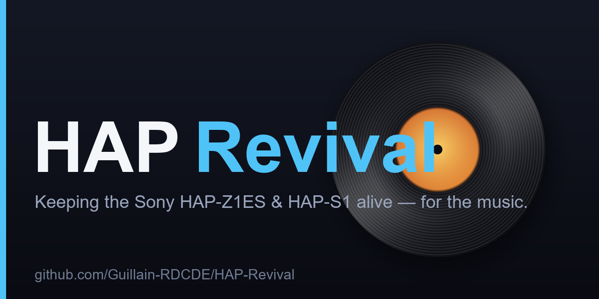

<!-- markdownlint-disable MD033 MD041 -->

  

**Open software for the Sony HAP-Z1ES and HAP-S1.**

Sony shipped a 2014 audiophile masterpiece, then stopped writing software for it in January 2021.
The hardware still sings. This is the rest of the story.

 

**Already working:** get music onto it · [a phone remote](docs/13-control-app.md) · internet radio · browse, search and audit your library · repair its tags and artwork.

 

&nbsp;

&nbsp;

[**Download HAP Sync**](https://github.com/Guillain-RDCDE/HAP-Revival/releases/latest) (it updates itself from then on) &nbsp;·&nbsp;
[I own a HAP](docs/REFERENCE.md#own-a-hap-start-here) &nbsp;·&nbsp;
[Phone remote](docs/13-control-app.md) &nbsp;·&nbsp;
[How it works](docs/REFERENCE.md#under-the-hood) &nbsp;·&nbsp;
[Documentation](docs/00-overview.md)

 

> [!CAUTION]
> **Sony switched off Spotify on the HAP-Z1ES and the HAP-S1 on 17 November 2026.**
>
> No firmware, no warning on the player, no replacement: a support notice, and Spotify Connect is
> gone from a high-end machine that still works perfectly. For many owners, Spotify was what this
> player was for. For the person who runs this project, it was 98% of all listening. The player
> still announces itself on the network as a Spotify device, but it no longer answers, so it has
> vanished from the Spotify app. Your own files and internet radio are not affected.
>
> We think this is a shameful way to treat the people who bought these players. It only makes us
> more determined to open the player up and put Spotify back on it ourselves. What we measured,
> what you can do today, and what we are doing about it:
> [Spotify, switched off by Sony](docs/REFERENCE.md#spotify-switched-off-by-sony-on-17-november-2026).

 

---

<!-- opening -->
> Sony stopped supporting its high-end music players in 2021. This keeps them alive and improving, on your own network.
>
> The device protocol reverse-engineered; a sync tool that updates itself, a phone remote, internet radio, library audit and tag repair; nothing leaves your network.
>
> A legacy system kept in service without its vendor. Part of the work of [Guillain d’Erceville](https://github.com/Guillain-RDCDE), forward deployed engineer.
<!-- opening -->

 

## More

**[Reference](docs/REFERENCE.md)** — getting started with a HAP, installing, how it works under the hood, the supported devices, the tools, and the full documentation index.

## License

Code (`tools/`, `tests/`, `api-spec/examples/`) is [MIT](LICENSE). Documentation and research
notes (`docs/`, `research/` and every other Markdown file) are [CC BY-SA 4.0](LICENSE-docs).
Not affiliated with Sony.

 

## Acknowledgements

**Amos**, who in one week contributed the Crestron module, measurements from a HAP-S1 this project
does not own, a firmware version nobody had recorded, and the two file names that led to the front
panel API. **Saschko**, for a second region's TuneIn tree. And the HAP owners on the Steve Hoffman
forums whose posts made several of these threads findable at all.
